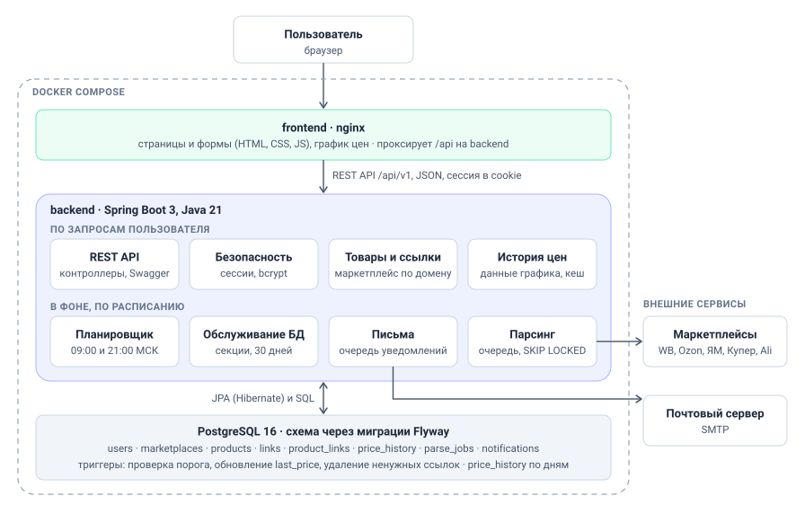

# Архитектура PriceTracker



Приложение состоит из трёх частей, которые запускаются в Docker-контейнерах через `docker compose`: фронтенд на nginx, бэкенд на Spring Boot и субд PostgreSQL. Снаружи остаются браузер пользователя, сайты маркетплейсов и почтовый сервер.

## Как читать схему

**Пользователь -> frontend.** Браузер открывает страницы, которые раздаёт nginx: регистрацию, вход, список товаров, форму добавления, страницу товара с графиком. Запросы к данным страницы отправляют на `/api/...`, а nginx пересылает их бэкенду. Поэтому фронтенд и API работают с одного адреса, cookie сессии передаётся автоматически.

**frontend -> backend.** Общение идёт по REST API `/api/v1` в формате JSON.

**Бэкенд: модули по запросам пользователя.** Они работают, только когда пользователь что-то делает на сайте.
- `REST API`: контроллеры принимают запросы, проверяют входные данные (Bean Validation)
- `Безопасность`: Spring Security. Регистрация с хешированием пароля bcrypt, вход с сессией, проверка, что пользователь работает только со своими товарами.
- `Товары и ссылки`: создание, изменение, пауза и удаление товаров. Определяет маркетплейс по домену ссылки и переиспользует ссылку, если за ней уже следит другой пользователь.
- `История цен`: отдаёт данные для графика за неделю или месяц. Результат кешируется до следующего сбора цен.

**Бэкенд: фоновые модули.** Они работают сами по расписанию, без участия пользователя.
- `Планировщик`: в 09:00 и 21:00 МСК создаёт задачи парсинга для всех ссылок активных товаров.
- `Парсинг`: несколько обработчиков параллельно забирают задачи из очереди, открывают страницы товаров на маркетплейсах и сохраняют цены. Для каждого маркетплейса свой парсер за общим интерфейсом.
- `Письма`: забирает записи из очереди уведомлений и отправляет письма через SMTP.
- `Обслуживание БД`: раз в сутки создаёт секции истории цен на следующие дни и удаляет секции старше 30 дней.

**backend <-> PostgreSQL.** Обычные операции идут через JPA (Hibernate), запросы к истории цен и очереди — через SQL. Схема базы создаётся только миграциями Flyway. Hibernate её лишь сверяет.

**PostgreSQL.** Хранит всё: пользователей, справочник маркетплейсов, товары, общие ссылки, историю цен, очередь задач и очередь писем. Часть бизнес-логики живёт прямо в базе:
- триггер после записи цены обновляет `last_price` у ссылки и создаёт уведомление, если цена опустилась ниже порога;
- триггер удаляет ссылку вместе с её историей, когда за ней больше никто не следит;
- таблица `price_history` разбита на секции по дням, поэтому график читает только нужные дни, а старые данные удаляются целой секцией.

## Основные потоки данных

### Пользователь добавляет товар
1. Форма на фронтенде проверяет поля и отправляет `POST /api/v1/products`.
2. `Безопасность` проверяет сессию.
3. `Товары и ссылки` в одной транзакции создаёт товар, находит или создаёт ссылки и связывает их с товаром.
4. Ответ возвращается на фронтенд, открывается страница товара.

### Система собирает цены
1. `Планировщик` в 09:00 и 21:00 записывает задачи в `parse_jobs`.
2. Обработчики `Парсинга` забирают задачи, обращаются к маркетплейсам и пишут цены в `price_history`.
3. Триггер в той же транзакции обновляет текущую цену ссылки и при пересечении порога создаёт запись в `notifications`.
4. `Письма` отправляет уведомления через SMTP.

### Пользователь смотрит график
1. Страница товара запрашивает `GET /api/v1/products/{id}/history?period=week`.
2. `История цен` берёт данные из кеша или читает из `price_history` только секции за нужные дни.
3. Фронтенд рисует по линии на каждую ссылку и пунктир порога.


## Структура репозитория

```
PriceTracker/
├── backend/                  
│   ├── pom.xml
│   └── src/main/
│       ├── java/ru/project/
│       │   ├── api/          контроллеры REST API
│       │   ├── security/     настройки Spring Security
│       │   ├── product/      товары и ссылки
│       │   ├── history/      история цен
│       │   ├── parsing/      планировщик, очередь, парсеры маркетплейсов
│       │   ├── notification/ отправка писем
│       │   └── maintenance/  обслуживание секций
│       └── resources/db/migration/   миграции Flyway
├── frontend/                 страницы, стили, скрипты, конфиг nginx
├── docs/                     ТЗ, макеты, пользовательские пути, архитектура
├── .github/workflows/        CI
└── docker-compose.yml
```

Пакеты бэкенда, `frontend/` и `docker-compose.yml` пока запланированы и появятся по ходу разработки.
