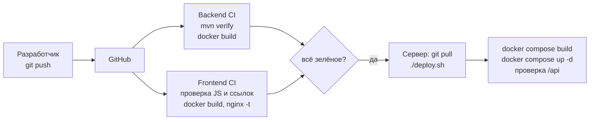
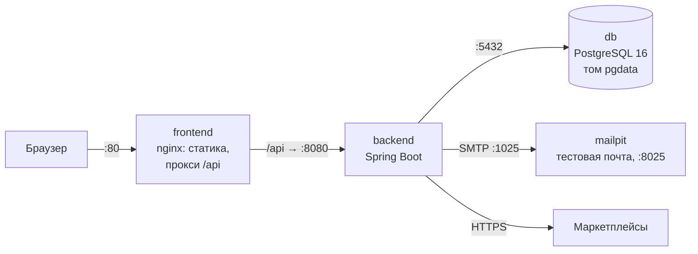

# CI/CD и развёртывание

## Путь изменения от коммита до работающего сайта

- **Backend CI** (`.github/workflows/backend.yml`) запускается при изменениях в `backend/`: сборка и тесты Maven, затем сборка Docker-образа.
- **Frontend CI** (`.github/workflows/frontend.yml`) запускается при изменениях в `frontend/`: проверка синтаксиса JavaScript, ссылок между файлами, сборка образа nginx и проверка его конфигурации.
- **Развёртывание** — скрипт `deploy.sh`: собирает образы, запускает контейнеры, ждёт готовности бэкенда и проверяет, что сайт отвечает. Миграции БД применяет Flyway при старте бэкенда.

## Контейнеры

| Сервис | Образ | Наружу | Готовность |
|---|---|---|---|
| `db` | `postgres:16` | 5432 (для разработки) | `pg_isready` |
| `backend` | собирается из `backend/Dockerfile` | — | `GET /actuator/health` |
| `frontend` | собирается из `frontend/Dockerfile` | 80 | — |
| `mailpit` | `axllent/mailpit` | 1025, 8025 | — |

Порядок запуска: `db` (healthy) → `backend` (healthy) → `frontend`.