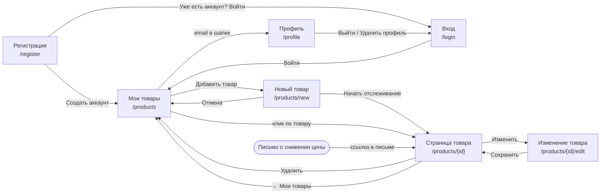

# Пользовательские пути PriceTracker

Документ описывает, как пользователь работает с приложением: с какого экрана начинает, какие шаги проходит и что в это время происходит в системе. Экраны соответствуют макету [`МАКЕТ.pdf`](./МАКЕТ.pdf), адреса API и таблицы БД — техническому заданию [`tz_price_monitoring.xml`](./tz_price_monitoring.xml).

## Карта экранов

Экраны «Регистрация», «Мои товары», «Новый товар» и «Страница товара» есть в макете. «Вход», «Изменение товара» и «Профиль» строятся на тех же элементах и в основной макет не вынесены.

## Действующие лица

- **Гость** — человек без аккаунта или не вошедший в систему. Видит только регистрацию и вход.
- **Пользователь** — вошедший в систему. Работает только со своими товарами.
- **Система** — планировщик и обработчики парсинга, которые без участия пользователя собирают цены в 09:00 и 21:00 МСК и отправляют письма.

---

## 1. Регистрация

**Кто:** гость. **Начало:** экран «Регистрация».

1. Гость вводит электронную почту, пароль и повтор пароля.
2. Отмечает согласие получать письма о снижении цены.
3. Нажимает «Создать аккаунт».
4. Попадает на экран «Мои товары». Список пуст, на экране подсказка добавить первый товар.

**Проверки на форме, до отправки:**
- почта в правильном формате;
- пароль не короче 8 символов, содержит буквы и цифры;
- пароли совпадают. Иначе под полем видно сообщение «Пароли не совпадают».

**Что происходит в системе:**
`POST /api/v1/auth/register` - в таблице `users` создаётся строка. Пароль сохраняется только в виде bcrypt-хеша. После этого создаётся сессия.

**Если что-то пошло не так:**
- почта уже зарегистрирована - сервер отвечает 409, под полем почты появляется «Этот адрес уже зарегистрирован. Войдите или используйте другой»;
- поля заполнены неверно - форма не отправляется, ошибки показаны под соответствующими полями.

## 2. Вход

**Кто:** гость. **Начало:** экран «Вход» (или ссылка «Уже есть аккаунт? Войти» на регистрации).

1. Гость вводит почту и пароль и нажимает «Войти».
2. Попадает на экран «Мои товары».

**В системе:** `POST /api/v1/auth/login`, Spring Security проверяет пароль по хешу и создаёт сессию в cookie.

**Если что-то пошло не так:** при неверной паре «почта — пароль» показывается одно общее сообщение «Неверная почта или пароль», без уточнения, какое поле неверно.

Если пользователь открывает любую внутреннюю страницу без входа, его перенаправляет на «Вход».

## 3. Добавление товара

**Кто:** пользователь. **Начало:** «Мои товары» - кнопка «Добавить товар» (или «Добавить» в шапке).

1. Пользователь вводит название товара.
2. Вводит порог в поле «Уведомить, если цена ниже».
3. Вставляет ссылку на страницу товара в магазине. Рядом со ссылкой сразу появляется метка маркетплейса (Wildberries, Ozon, Я. Маркет…).
4. Кнопкой «Добавить ссылку» добавляет ссылки на этот же товар в других магазинах, от 1 до 10.
5. Нажимает «Начать отслеживание».
6. Попадает на страницу товара. Пока цены не собраны, вместо графика видна надпись «Первая проверка цен — сегодня в 21:00».

**Проверки на форме:**
- название не пустое;
- порог больше нуля;
- хотя бы одна ссылка;
- домен каждой ссылки есть в списке поддерживаемых. Для неподдерживаемого сайта метка «—», рамка поля красная, под ним: «Этот сайт не поддерживается. Доступны: Wildberries, Ozon, Яндекс Маркет, Купер, AliExpress».

**Что происходит в системе** (одна транзакция):
- `POST /api/v1/products` - строка в `products` со статусом `active`;
- для каждой ссылки маркетплейс определяется по домену через `marketplace_domains`;
- если такая ссылка уже есть в системе (её отслеживает другой пользователь), используется существующая строка `links`, иначе создаётся новая. Поэтому одна страница магазина парсится один раз, сколько бы людей за ней ни следили;
- связи товара со ссылками записываются в `product_links`.

**Если что-то пошло не так:** если хотя бы одна ссылка не прошла проверку на сервере, товар не создаётся целиком, и пользователь остаётся на форме с отмеченной ошибкой. У одного пользователя не может быть двух товаров с одинаковым названием.

## 4. Просмотр истории цены

**Кто:** пользователь. **Начало:** «Мои товары» - клик по товару (или ссылка из письма).

1. На странице товара видно название, статус, порог и время последней проверки.
2. График «История цены» показывает цену по каждой ссылке отдельной линией и порог пунктиром. По умолчанию выбран период «Неделя».
3. Переключатель «Неделя / Месяц» меняет период графика.
4. При наведении на точку видны дата, время и цена замера.
5. В таблице «Ссылки» указаны маркетплейс, текущая цена и ссылка «Открыть», которая ведёт на страницу товара в магазине.

**В системе:** `GET /api/v1/products/{id}/history?period=week|month`. Запрос использует первичный ключ `(link_id, captured_at)` и читает только секции таблицы за нужные дни.

**Ограничение:** история хранится 30 дней, поэтому самый длинный период на графике — месяц.

## 5. Обзор своих товаров

**Кто:** пользователь. **Начало:** «Мои товары» — главный экран после входа.

1. В списке у каждого товара видно название, лучшую текущую цену среди его ссылок и статус: «Ниже порога», «Отслеживается» или «На паузе».
2. Фильтры над списком: «Все», «Ниже порога», «Отслеживаются», «На паузе». У каждого фильтра указано число товаров.
3. Товары ниже порога стоят в начале списка, товары на паузе приглушены.
4. Под заголовком указано время следующей проверки цен.

**В системе:** `GET /api/v1/products?status=…`. Текущая цена берётся из `links.last_price`, без обхода всей истории цен.

## 6. Пауза и возобновление отслеживания

**Кто:** пользователь. **Начало:** страница товара.

1. Пользователь нажимает «Пауза».
2. Статус меняется на «На паузе», кнопка превращается в «Возобновить».
3. Повторное нажатие возвращает статус «Отслеживается».

**В системе:** `PATCH /api/v1/products/{id}/status` меняет `products.status`. Пока товар на паузе, по нему не создаются уведомления. Если его ссылки не отслеживает никто другой, по ним не создаются и задачи парсинга. Сам товар и его история сохраняются.

## 7. Изменение товара

**Кто:** пользователь. **Начало:** страница товара - «Изменить».

1. Открывается та же форма, что при добавлении, с заполненными полями.
2. Пользователь меняет название, порог или набор ссылок и нажимает «Сохранить».
3. Возвращается на страницу товара.

**В системе:** `PUT /api/v1/products/{id}`. Проверки те же, что при добавлении. Если после удаления ссылки за ней больше никто не следит, триггер удаляет её вместе с историей цен.

## 8. Удаление товара

**Кто:** пользователь (только владелец товара). **Начало:** страница товара - «Удалить».

1. Пользователь нажимает «Удалить».
2. Возвращается на «Мои товары», товара в списке больше нет.

**В системе:** `DELETE /api/v1/products/{id}`. Каскадно удаляются связи товара со ссылками и его уведомления. Ссылка, за которой больше никто не следит, удаляется триггером вместе с историей цен и задачами парсинга. История общей ссылки сохраняется, если её отслеживает другой пользователь.

## 9. Выход и удаление профиля

**Кто:** пользователь. **Начало:** «Выйти» в шапке или экран «Профиль».

**Выход:** «Выйти» завершает сессию (`POST /api/v1/auth/logout`) и открывает экран «Вход».

**Удаление профиля:**
1. На экране «Профиль» пользователь нажимает «Удалить профиль».
2. На странице появляется подтверждение с предупреждением, что все товары и их история будут удалены без возможности восстановления.
3. После подтверждения сессия завершается и открывается экран «Вход».

**В системе:** `DELETE /api/v1/me` → одна команда `DELETE FROM users`. Всё остальное удаляется каскадно: товары, связи со ссылками, уведомления, а также ссылки, за которыми больше никто не следит, с их историей.

---

## Сквозной сценарий для демонстрации

регистрация - добавление товара с тремя ссылками - сбор цен - письмо о снижении цены - просмотр графика за неделю - пауза - удаление товара - удаление профиля
